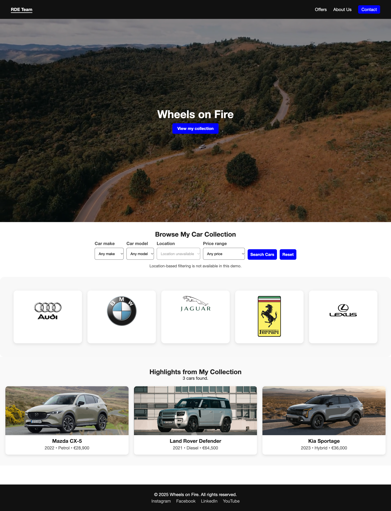

<h1 align="center">Wheels on Fire</h1>

<p align="center">
  A car collection and community website by the RDE Team.
</p>

<p align="center">
  
  
  
</p>

<p align="center">
  <a href="https://askada21.github.io/WebDev_Project_RDE/">
    🌐 Live Demo
  </a>
</p>

## Overview

Wheels on Fire is a responsive, multi-page website showcasing John O’Reilly’s car collection, his story, and an archived community event. Built with HTML, CSS, and vanilla JavaScript, it includes interactive collection filters and a browser-only contact-form demo.

## Key features

- **Browse and filter:** Explore three vehicle cards with photographs and specifications; filter by make, model, and price, with result counts and reset controls.
- **Explore the story:** A muted, looping video introduces the collection, while the About page presents the collector’s background.
- **View the event archive:** Read about the Dublin car meet on 26 November 2025, clearly marked as a past event with a closed offer.
- **Try contact validation:** Required-field, whitespace, and email checks provide field-specific errors and a validation status message.
- **Navigate across devices:** Shared navigation, responsive grids, keyboard focus indicators, and consistent footers support the four main pages.

## Project Preview

### Desktop View



### Mobile View


### Explore the Pages

| Page | What to explore | Source |
| --- | --- | --- |
| Home | Video introduction, brand gallery, and car filters | [index.html](index.html) |
| About | Collector biography and short-page footer layout | [about.html](pages/about.html) |
| Contact | Form fields and validation feedback | [contact.html](pages/contact.html) |
| Offers | Archived event details and closed offer | [offers.html](pages/offers.html) |

## Tech stack

| Technology | Purpose |
| --- | --- |
| HTML5 | Page structure, semantic landmarks, forms, and embedded video |
| CSS | Shared styling, Grid and Flexbox layouts, media queries, and focus states |
| Vanilla JavaScript | DOM-based car filtering and client-side form validation |
| Local media | JPEG photographs, PNG/SVG logos, an SVG favicon, and MP4 video |

The site has no framework, package dependencies, build step, backend, or database. Python is optional tooling for the local server described below; it is not part of the website runtime.

## Project structure

```text
WebDev_Project_RDE/
├── index.html           # Home page and collection
├── events_offers.html   # Legacy redirect to the Offers archive
├── pages/
│   ├── about.html
│   ├── contact.html
│   └── offers.html
├── css/style.css        # Shared and responsive styles
├── script/main.js       # Filters and contact validation
├── media/               # Photos, logos, favicon, and hero video
├── screenshots/         # Desktop and mobile page previews
└── README.md
```

## Getting started

Use a modern web browser. To serve the site locally with the command below, install Python 3. Git is needed only if you clone the repository rather than download it.

1. Clone your team's repository or fork, then open its `WebDev_Project_RDE` directory. If you already have a checkout, use that directory.
2. From the project root, start a local static server:

   ```sh
   python3 -m http.server 8000 --bind 127.0.0.1
   ```

3. Open [the local home page](http://127.0.0.1:8000/index.html) in your browser.
4. Stop the server with `Ctrl+C` when finished.

No installation command, environment variables, credentials, or build process is required. Keep the folder structure intact so relative asset and navigation paths resolve correctly. You can also use another static server rooted at the project directory.

To explore the implementation, start with [index.html](index.html), [the shared stylesheet](css/style.css), and [the JavaScript](script/main.js).

## Responsive design and accessibility

- **Responsive layout:** Media queries adapt navigation, grids, filters, and forms. A Flexbox page layout keeps short-page footers at the viewport bottom without overlapping content.
- **Keyboard access:** Skip links, focusable main landmarks, visible focus rings, and scroll spacing keep navigation and controls accessible around the responsive header.
- **Page structure:** Descriptive titles, labelled navigation landmarks, and current-page indicators help users orient themselves.
- **Form feedback:** Associated labels, field-level errors, `aria-invalid`, polite status announcements, and focus on the first invalid field support validation. Control borders provide approximately **4.54:1** contrast against white.
- **Images and motion:** Collection and logo images include alternative text, explicit dimensions, and lazy loading. Reduced-motion settings suppress decorative effects and smooth search scrolling; the hero video remains an exception.
- **Without JavaScript:** The full collection stays visible; filtering and contact validation are disabled with explanatory messages.

These improvements do not constitute a full accessibility conformance audit.

## Testing and QA

Development regression checks passed for all four pages in desktop Chrome at **375px, 768px, and 1440px** viewport widths.

| Area | Verified behavior |
| --- | --- |
| Layout | No horizontal overflow or clipping; footers reach the bottom on short pages and remain below content on longer pages. |
| Navigation and keyboard | Page links, collection anchor, legacy Offers redirect, skip links, and visible, unobscured keyboard focus work as intended. |
| Filters | Make/model/price combinations, empty results, incompatible-model clearing, and reset to all three cars work correctly. |
| Contact form | Empty fields, whitespace, and invalid email are rejected; valid details display the explicit no-delivery message. |
| Media and fallbacks | Assets load, visible video loops, reduced-motion effects and JavaScript-disabled fallbacks work; no JavaScript exceptions or HTTP failures were recorded. |

These checks cover browser viewport sizes, not every browser, physical device, or assistive technology. No automated test runner or QA scripts are committed. To repeat the checks, serve the site locally, test the widths above in developer tools, and run `git diff --check` before submitting changes.

## Team collaboration and contributions

Created by the **RDE Team**, with individual contributions recorded in Git history. Keep contributions focused, reuse shared styles and scripts, and include validation results for all four pages in the team's review process.

## Known limitations

- **Demo contact form:** Browser-only validation; no message delivery or application storage.
- **Static collection:** Three hardcoded cars, no inventory API or database, and no location filtering.
- **Unavailable actions:** Event tickets and calendar downloads are closed; footer social names are non-interactive placeholders.
- **Autoplay video:** The hero video loops without a pause control and continues playing under reduced-motion preferences.
